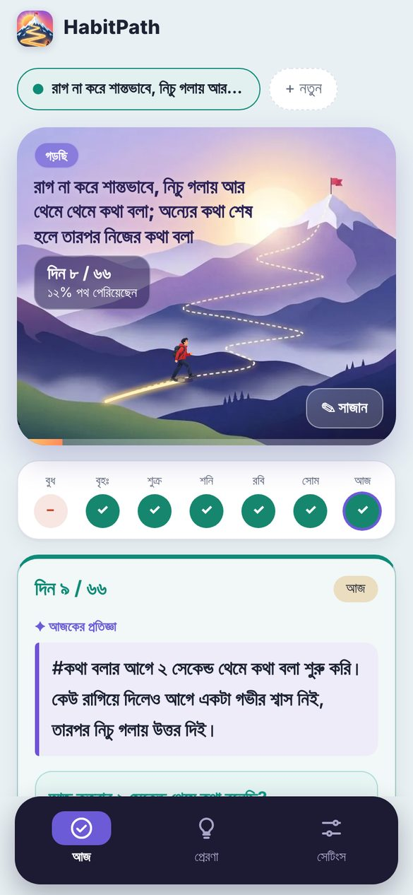
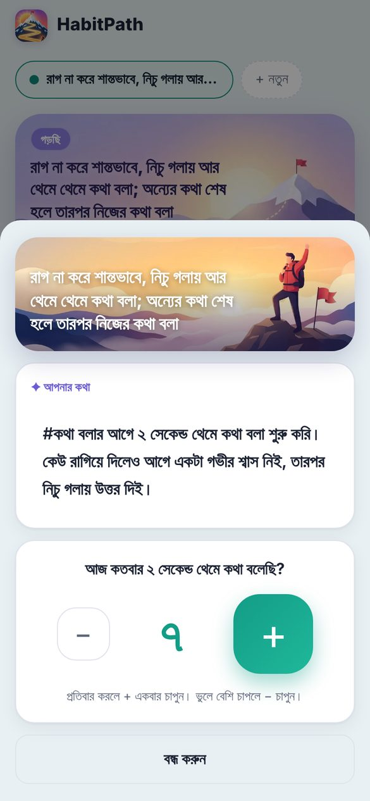
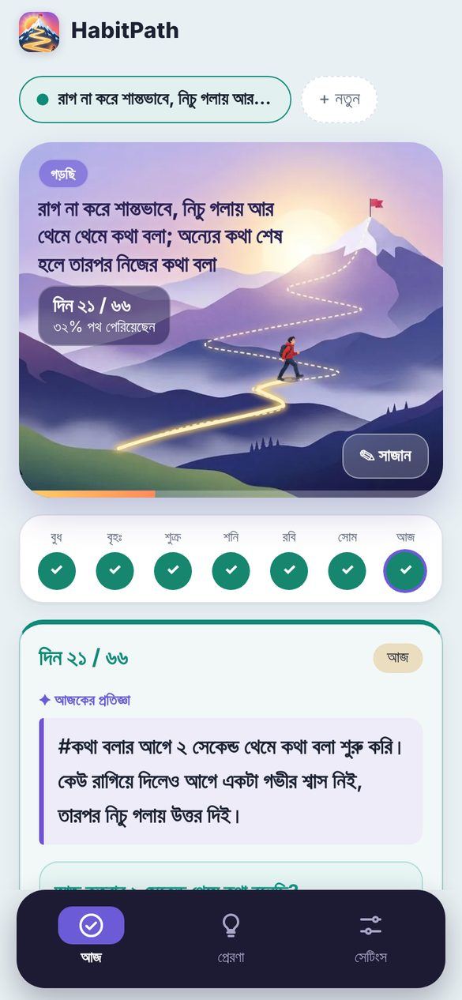
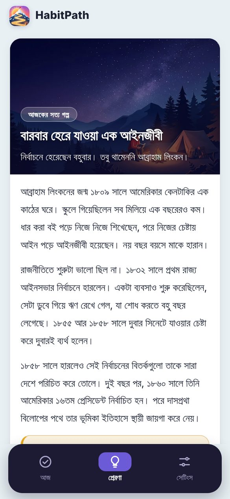
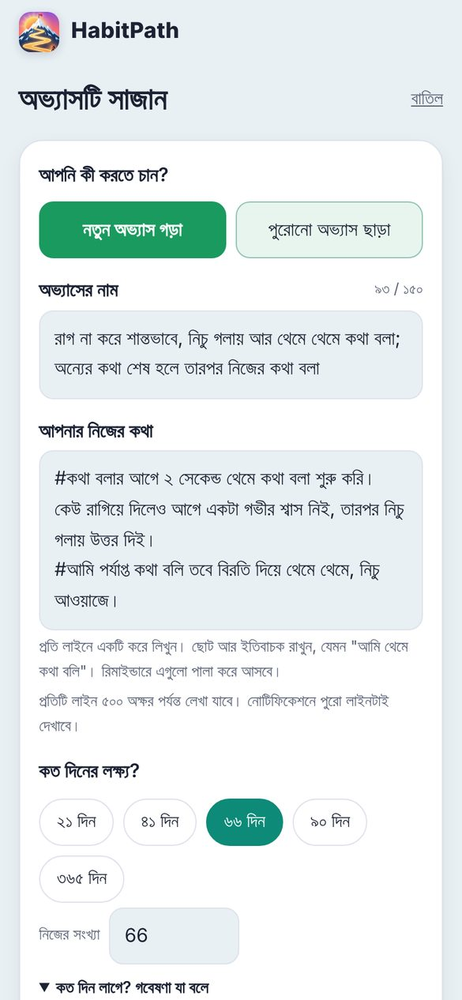
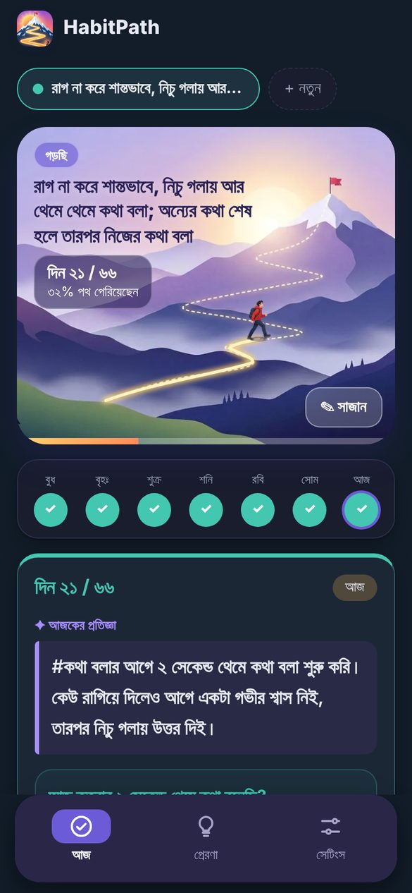

<h1 align="center">HabitPath</h1>

<b>ছোট ছোট দিনে বড় পরিবর্তন</b> ভালো অভ্যাস গড়ার আর খারাপ অভ্যাস ছাড়ার বিনামূল্যের Android অ্যাপ

  <a href="https://github.com/amin2036/HabitPath/raw/main/HabitPath.apk"><b>📥 এখানে চাপুন: HabitPath ডাউনলোড করুন (Android)</b></a>

---

## অ্যাপটি কী করে

- **যেকোনো অভ্যাস:** শান্তভাবে কথা বলা, হাঁটা, বই পড়া, ফোন কম দেখা, রাগ সামলানো, যা খুশি
- **মেয়াদ নিজে বাছবেন:** ২১, ৪১, ৬৬ বা ৩৬৫ দিন, গবেষণাভিত্তিক পরামর্শসহ
- **সময়মতো রিমাইন্ডার:** নিজের লেখা লাইন (নোটিফিকেশনে পুরোটা দেখায়), অথবা প্রতিবার নতুন একটি প্রেরণা (৩,০০০+ লেখা, একই লেখা বারবার আসে না)
- **নোটিফিকেশন থেকেই গোনা:** "+১ যোগ করুন" বোতাম, যতবার চাপবেন ততবার বাড়বে, অ্যাপ খুলতে হয় না
- **প্রতিদিন সকালে একটি সত্য গল্প:** বাস্তব মানুষের কষ্ট পেরিয়ে এগিয়ে যাওয়ার গল্প, শিক্ষা আর সূত্রসহ
- **প্রতিদিনের হিসাব:** যত দিন এগোবেন, ছবির যাত্রী তত পাহাড়ের চূড়ার দিকে উঠবে
- **কুরআন ও হাদিস (ইচ্ছা হলে):** প্রতিটির সূত্র যাচাই করা, না চাইলে বন্ধ রাখা যায়
- **ইন্টারনেট লাগে না, বিজ্ঞাপন নেই।** আপনার সব তথ্য শুধু আপনার ফোনে থাকে।

  
  
  

  
  
  

## কীভাবে ইনস্টল করবেন

শুধু Android ফোনে চলবে (Android ৭ বা তার পরের)। iPhone-এ চলবে না।

1. উপরের **ডাউনলোড** লিংকে চাপুন, `HabitPath.apk` ফাইলটি নামবে।
2. ডাউনলোড শেষে ফাইলটি খুলে **Install** চাপুন। প্রথমবার অনুমতি চাইলে **Allow from this source** চালু করুন।
3. *"This app isn't a verified app from Google Play"* লেখা এলে **Got it নয়, "Install anyway"** চাপুন। Play Store-এর বাইরের সব অ্যাপেই এই সতর্কবার্তা আসে। "Install anyway" না দেখালে **More details** চাপুন।
4. অ্যাপ খুলে নোটিফিকেশনের অনুমতি দিন, তারপর অভ্যাস বেছে নিন।

**রিমাইন্ডার ঠিকমতো পেতে:** অ্যাপের সেটিংসে "রিমাইন্ডার ঠিকমতো পেতে" অংশে যা সবুজ নয়, তার পাশে "খুলুন" চাপুন। Xiaomi / Redmi / POCO ফোনে Autostart, Battery saver → No restrictions আর Floating notifications চালু করুন।

**নতুন সংস্করণ:** একই লিংক থেকে নামিয়ে আগেরটার উপরেই ইনস্টল করুন। আপনার হিসাব মুছবে না।

**বর্তমান সংস্করণ: ০.৬.০**
- নতুন লোগো আর পুরো নতুন ডিজাইন: প্রতিটি অংশে আঁকা ছবি
- দিন যত এগোবে, ছবির যাত্রী পাহাড়ের পথ ধরে চূড়ার দিকে উঠবে
- নোটিফিকেশনে আপনার পুরো লেখা দেখা যায়, আর একটা "+১ যোগ করুন" বোতাম
- অভ্যাসের নাম ১৫০ অক্ষর পর্যন্ত, নিজের প্রতিটি কথা ৫০০ অক্ষর পর্যন্ত
- আজকের পাতায় শেষ ৭ দিনের হিসাব

**আগের সংস্করণ ০.৫.০:** সকালের সত্য গল্প (৭৪টি), ৩,০০০+ প্রেরণার লেখা, রঙিন ঘর আর বোতাম

---

## English

**HabitPath** is a free Android app for building good habits and breaking bad ones, in Bengali and English. Track any habit for 21, 41, 66 or 365 days, get reminders with your own lines or 3,000+ motivational messages that never repeat, read a true story every morning, and watch a hiker climb the trail towards the summit as your days add up. Your own lines show in full in the notification, which has a "+1" button to count without opening the app. Quran and Hadith content is optional and every item cites its source. Works offline, no ads, and all your data stays on your phone.

**[Download the latest APK](https://github.com/amin2036/HabitPath/raw/main/HabitPath.apk)** · Android 7.0 or later. During install, tap **Install anyway** if Play Protect shows a warning.
